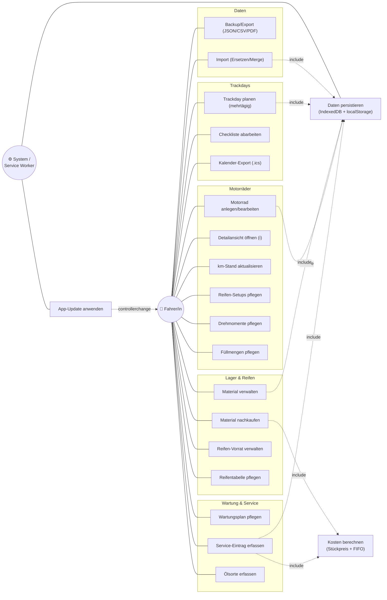
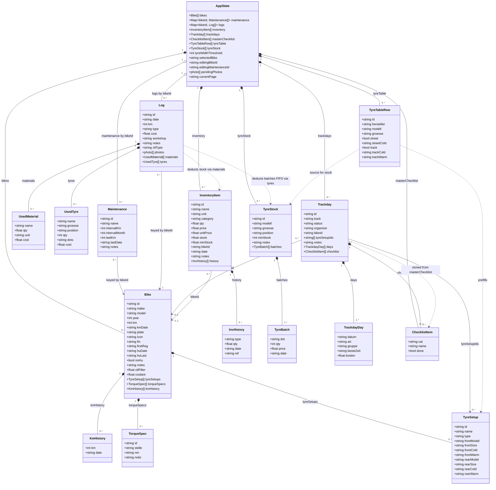
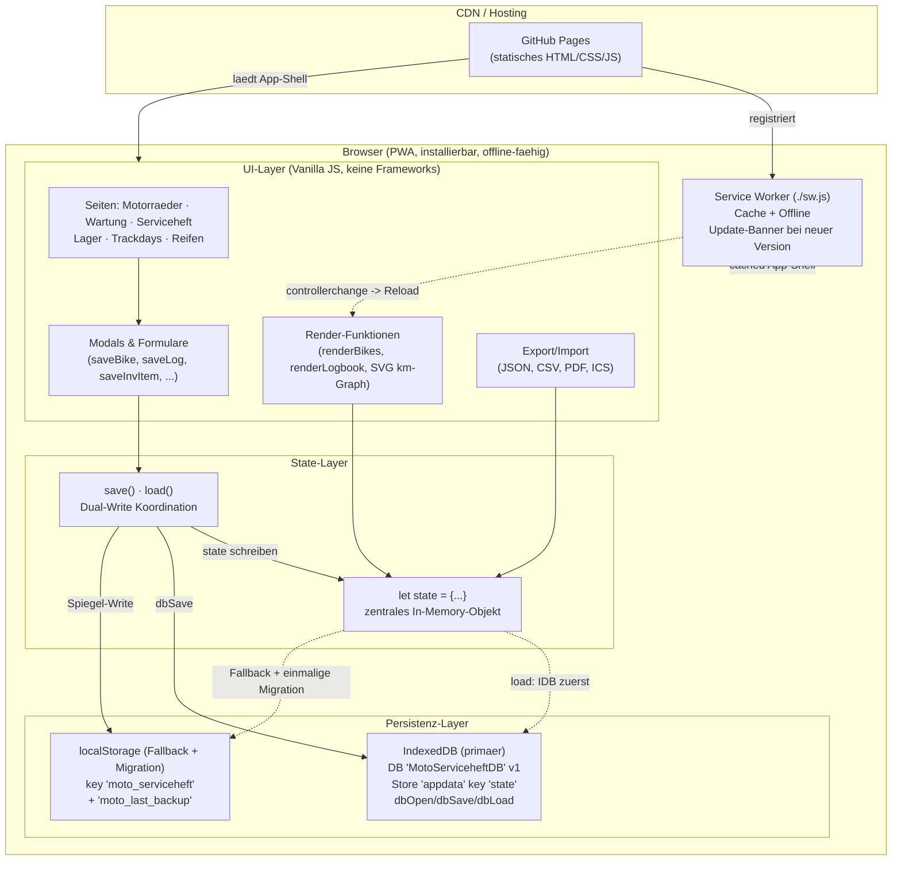
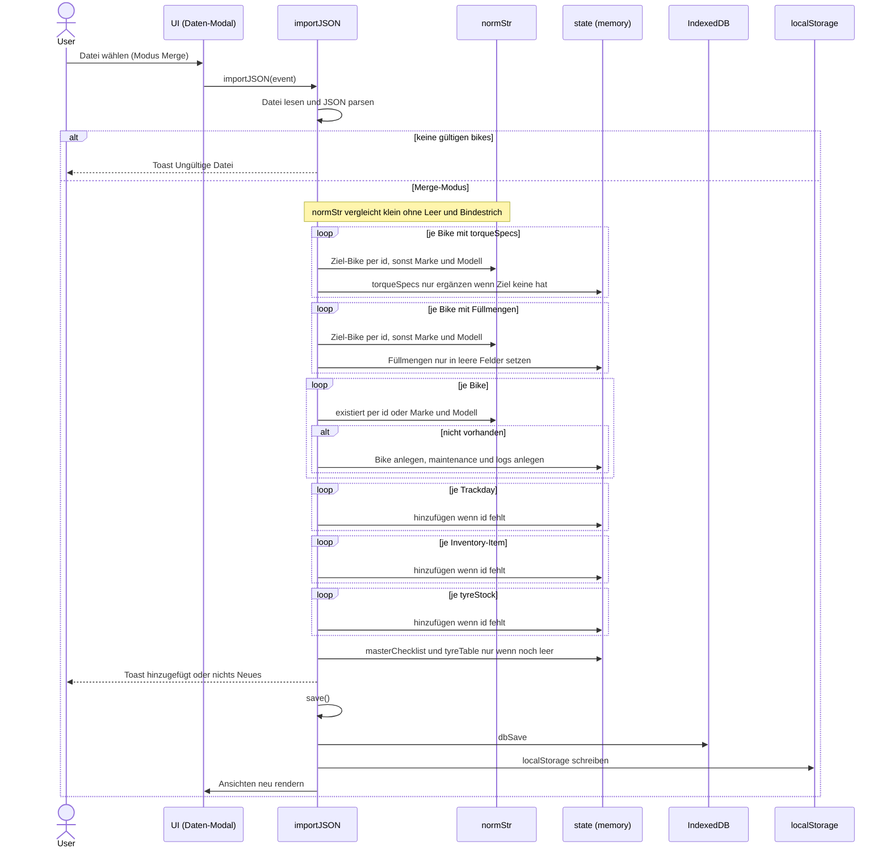
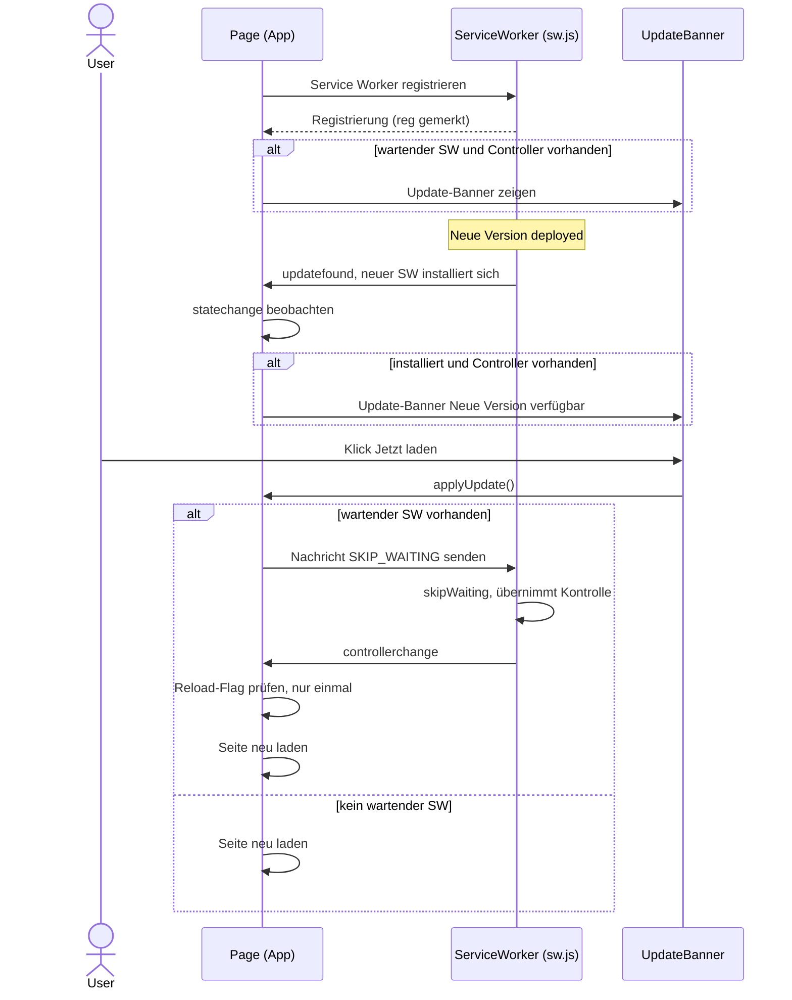
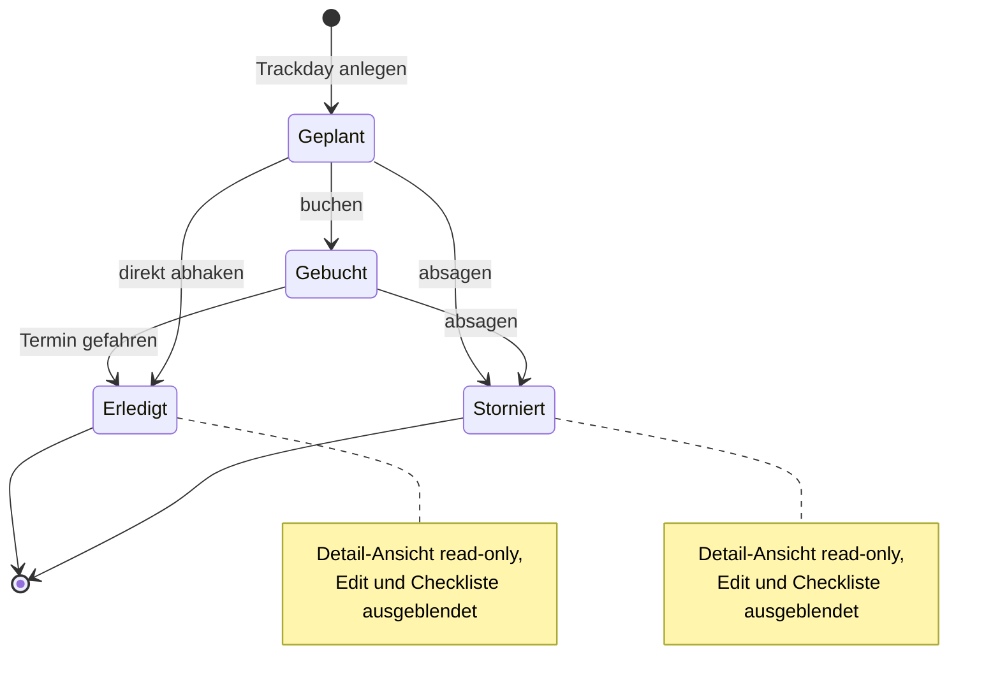

# BikerDesk — Detail-Design (UML)

**Stand:** App-Version v53 · September 2026
**Quelle:** abgeleitet aus dem echten Code (`index.html`, main, v53)
**Notation:** Mermaid (rendert in VS Code, GitHub, den meisten Markdown-Viewern)

BikerDesk ist eine Single-File Vanilla-HTML/CSS/JS-PWA mit einem zentralen In-Memory
`state`-Objekt, das per IndexedDB (primär) und localStorage (Fallback) persistiert wird.
Kein Framework, kein Backend — Hosting über GitHub Pages, Offline-Fähigkeit über einen
Service Worker.

---

## 1. Anwendungsfälle (Use-Case-Sicht)

Akteure: **Fahrer/in** (einziger menschlicher Nutzer) und **System / Service Worker**
(technischer Akteur für Persistenz und Update). Mermaid kennt kein natives
UML-Use-Case-Diagramm — hier als gruppiertes Diagramm mit `include`-Beziehungen für
die wiederkehrenden Kernabläufe (Persistenz, Kostenberechnung).

---

## 2. Statische Sicht

### 2.1 Datenmodell (Klassendiagramm)

Das zentrale `state`-Objekt und alle Entitäten mit ihren tatsächlich im Code
erzeugten/gespeicherten Feldern (inkl. abgeleiteter Felder wie `kmDate`, `unitPrice`).

### 2.2 Komponentensicht

> Hinweis: `sw.js` wird per `navigator.serviceWorker.register('./sw.js')` eingebunden,
> liegt aber nicht im selben Repo-Verzeichnis wie `index.html` — die Cache-Details sind
> aus dem Registrierungscode abgeleitet.

---

## 3. Dynamische Sicht

### 3.1 Service-Eintrag speichern mit Material- und Reifenverbrauch (`saveLog()`)

```mermaid
sequenceDiagram
    actor User
    participant UI as UI (Log-Modal)
    participant saveLog
    participant invUnitPrice
    participant tyreConsume
    participant State as state (memory)
    participant IDB as IndexedDB
    participant LS as localStorage

    User->>UI: Material wählen (onLogMaterialSelect)
    UI->>invUnitPrice: Stückpreis für inv
    invUnitPrice-->>UI: unitPrice oder 0
    User->>UI: Reifen aus Vorrat wählen (logTyres)
    UI->>UI: updateLogCostPreview()
    Note over UI: Live-Vorschau Material plus Reifen plus manuelle Kosten

    User->>UI: Speichern
    UI->>saveLog: saveLog()
    saveLog->>saveLog: Pflichtfelder prüfen (date, km, type)
    alt Felder fehlen
        saveLog-->>User: Toast Pflichtfelder fehlen
    else gültig
        loop je gewähltes Material
            saveLog->>invUnitPrice: invUnitPrice(inv)
            invUnitPrice-->>saveLog: unitPrice
            saveLog->>saveLog: materialCost erhöhen
            saveLog->>State: inv.stock reduzieren, nicht unter null
            saveLog->>State: inv.history Verbrauch anhängen
        end
        loop je gewählter Reifen
            saveLog->>tyreConsume: tyreConsume(t, qty)
            Note over tyreConsume: FIFO über Chargen, älteste DOT zuerst
            tyreConsume->>State: Chargenmenge reduzieren, leere Chargen entfernen
            tyreConsume-->>saveLog: taken, cost, dots
            saveLog->>saveLog: tyreCost erhöhen
        end
        saveLog->>saveLog: totalCost gleich manuell plus Material plus Reifen
        saveLog->>State: log erzeugen und voranstellen
        saveLog->>State: bike km, kmDate, kmHistory aktualisieren
        saveLog->>saveLog: save()
        saveLog->>IDB: dbSave als primär
        saveLog->>LS: localStorage als Fallback
        saveLog->>UI: Modal schliessen, Stats und Logbuch neu rendern
        saveLog-->>User: Toast Eintrag gespeichert
    end
```

### 3.2 JSON Merge-Import (`importJSON()`, mode='merge')

### 3.3 App-Update via Service Worker

### 3.4 Trackday-Status (Zustandsdiagramm)

---

## Anmerkungen

- Die Feldlisten stammen aus den `save*`-Funktionen (nicht nur aus den Formularen),
  inkl. abgeleiteter Felder (`kmDate`, `unitPrice`).
- `logs` und `maintenance` sind im `state` nach `bikeId` verschlüsselt
  (`state.logs[bikeId] = [...]`), daher als assoziative Beziehung modelliert.
- Der **feste Stückpreis** (`unitPrice`) macht die Kostenrechnung robust gegenüber
  wechselnder Bedeutung von `qty` (Kaufmenge vs. aktueller Bestand nach Nachkauf).
- Reifenverbrauch nutzt **FIFO** über `batches` (älteste DOT zuerst).
